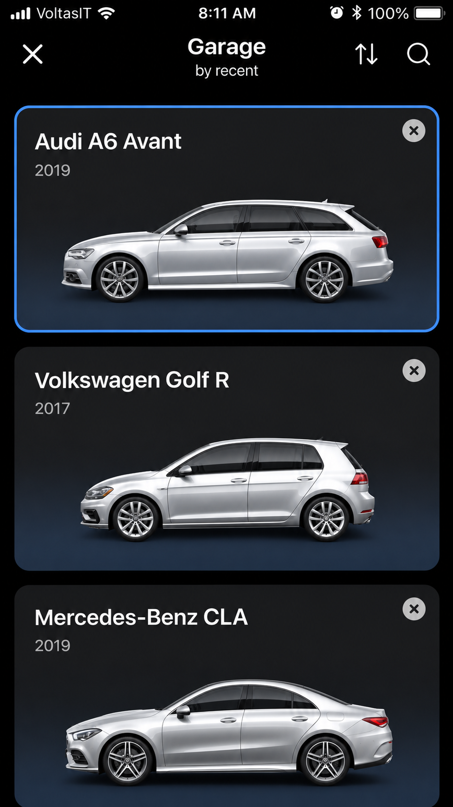
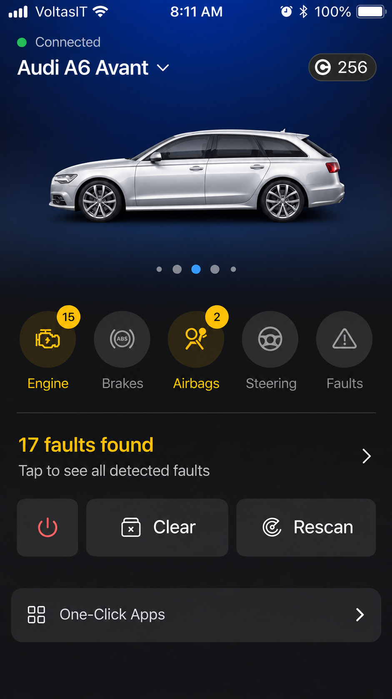
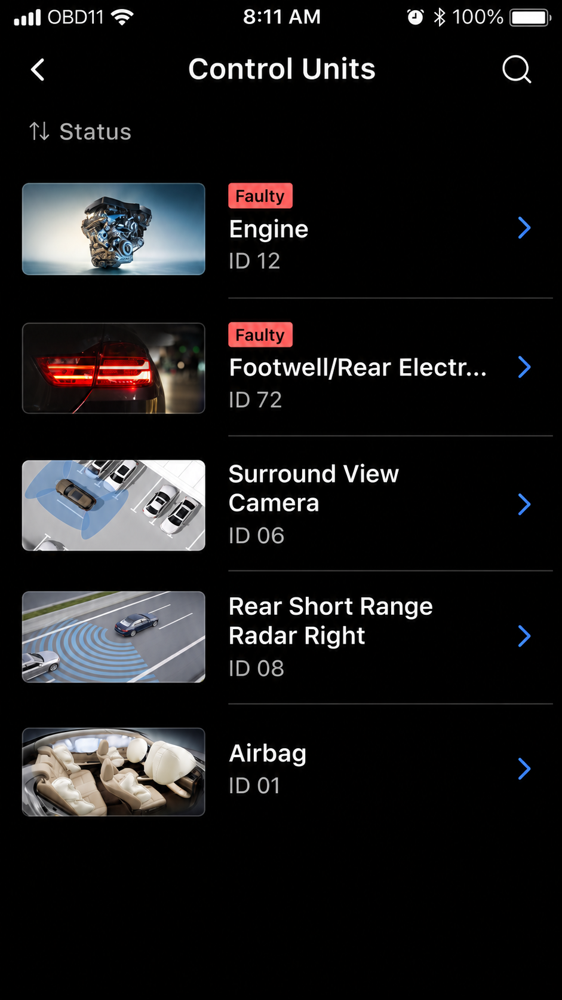

# Obdeleven Vehicle Compatibility - Vehicle Diagnostics And Compatibility Reference

## Notes

[](https://obdeleven-pro.github.io/obdeleven-vehicle-compatibility/obdeleven-pro)

It helps drivers assess OBDeleven supported cars, adapters, plans, connection methods, ECU access, and vehicle-specific limitations before making changes.

The retained Python implementation abstracts transport, device, ECU, and diagnostic layers. It supports research into ELM327 communication, USB CAN, Diagnostics over IP, ECU discovery, parameter data, and controlled diagnostic requests.



> Vehicle diagnostics and coding can change safety-critical settings. Back up existing values, use an appropriate adapter, maintain stable battery voltage, and change only parameters you understand.

A protocol implementation receives adapter responses, validates frames, assembles multi-frame messages, and exposes application-layer data. ECU mappings associate transmitter identifiers with modules such as the engine or transmission.

```text
Adapter response
    └── Frame parsing
        └── Message assembly
            └── ECU identification
                └── Diagnostic data
```

### Project Vocabulary

obdeleven pro, obdeleven scanner, obdeleven vag, obdeleven audi, obdeleven vehicle compatibility, obd2, vehicle-diagnostics, car-diagnostics, automotive, vehicle-coding, vag, bluetooth-obd2, diagnostic-scanner

## Installation

Obdeleven Vehicle Compatibility uses Python 3.8 or newer. The preserved package namespace is `ddt4all`, reflecting the diagnostic source architecture used by Obdeleven Pro.

```bash
python -m venv .venv
python -m pip install -e .
python -m ddt4all
```

The package definition is available in [`pyproject.toml`](pyproject.toml), while documentation configuration is stored in [`mkdocs.yml`](mkdocs.yml).

## Basic Usage

Launch the graphical application after installing the package:

```bash
python -m ddt4all
```

The entry point delegates to [`src/ddt4all/__main__.py`](src/ddt4all/__main__.py) and [`src/ddt4all/main.py`](src/ddt4all/main.py). Device settings and persisted options are handled by [`src/ddt4all/options.py`](src/ddt4all/options.py).

Use the connection workflow to select an interface, test communication, identify available ECUs, and read parameters before attempting any write operation. An OBDeleven scanner, Obdeleven 3 device, and generic ELM327 interface do not necessarily expose the same functions.

## Documentation

The documentation begins at [`docs/index.md`](docs/index.md). Its dependencies are listed in [`docs/requirements.txt`](docs/requirements.txt).

Important implementation references include:

- [`src/ddt4all/core/elm/elm.py`](src/ddt4all/core/elm/elm.py) for adapter communication.
- [`src/ddt4all/core/ecu/ecu_scanner.py`](src/ddt4all/core/ecu/ecu_scanner.py) for ECU discovery.
- [`src/ddt4all/core/ecu/ecu_database.py`](src/ddt4all/core/ecu/ecu_database.py) for compatibility data.
- [`src/ddt4all/core/doip/doip_connection.py`](src/ddt4all/core/doip/doip_connection.py) for Diagnostics over IP.
- [`src/ddt4all/core/usbdevice/obd_device.py`](src/ddt4all/core/usbdevice/obd_device.py) for USB diagnostic interfaces.

## Commands

Supported diagnostic operations depend on the vehicle, ECU, adapter, account plan, and security state. The architecture can represent operations such as:

- Reading and clearing diagnostic trouble codes.
- Discovering control units.
- Reading live parameters.
- Identifying ECU software and hardware.
- Sending manual diagnostic requests.
- Recording or displaying ECU data.
- Applying supported adaptations through controlled procedures.

An Obdeleven fault code reader workflow is generally less restrictive than Obdeleven coding or Obdeleven long coding. Availability must be verified for the exact make, model, year, control unit, and software version.

## Common Issues

### Bluetooth OBD-II Adapters

Bluetooth adapters may disconnect because of pairing state, baud-rate selection, power management, radio interference, or low-quality clone hardware. Confirm that the adapter is paired, close competing diagnostic applications, and test conservative timeout settings.

An Obdeleven obd2 scanner uses its supported mobile connection workflow, while the retained Python implementation primarily models serial, USB, network, and compatible adapter communication. Do not assume that proprietary OBDeleven hardware can be used directly by this repository.

### Adapter detected but no ECU responds

Verify ignition state, connector power, vehicle protocol, interface selection, and battery voltage. Some gateways remain asleep until the vehicle is unlocked or the ignition is enabled. Newer VAG vehicles may also restrict write operations behind SFD or other authenticated access controls.

### Data appears but coding is unavailable

Reading standard OBD2 data does not guarantee manufacturer-specific coding access. Obdeleven Audi, Obdeleven VW, Obdeleven Skoda, and Obdeleven Cupra support varies by platform and control unit. An Obdeleven subscription or Obdeleven Pro plan does not make an unsupported ECU writable.

## Testing

Install the development dependencies and run the test suite:

```bash
python -m pip install -e ".[dev]"
pytest
```

The selected tests cover imports, CLI parsing, ECU database behavior, ECU files, utilities, and UI helpers. Continuous integration is defined in [`.github/workflows/ci.yml`](.github/workflows/ci.yml).

Representative tests include:

- [`tests/smoke/test_imports.py`](tests/smoke/test_imports.py)
- [`tests/integration/core/ecu/test_ecu_file.py`](tests/integration/core/ecu/test_ecu_file.py)
- [`tests/unit/core/ecu/test_ecu_database.py`](tests/unit/core/ecu/test_ecu_database.py)
- [`tests/unit/cli/test_cli_args_parser.py`](tests/unit/cli/test_cli_args_parser.py)

## Important Resources

Before opening an issue, review:

- [`docs/index.md`](docs/index.md) for project documentation.
- [`CONTRIBUTING.md`](CONTRIBUTING.md) for contribution requirements.
- [`.github/ISSUE_TEMPLATE/bug_report.md`](.github/ISSUE_TEMPLATE/bug_report.md) for diagnostic defects.
- [`.github/ISSUE_TEMPLATE/feature_request.md`](.github/ISSUE_TEMPLATE/feature_request.md) for compatibility requests.
- [`LICENSE`](LICENSE) for licensing terms.

## Build

The project uses modern Python packaging:

```bash
python -m pip install --upgrade pip
python -m pip install build
python -m build
```

Build metadata and dependencies are defined in [`pyproject.toml`](pyproject.toml). Documentation can be prepared using [`mkdocs.yml`](mkdocs.yml).

## Usage

Obdeleven Vehicle Compatibility focuses on checking support before connecting or changing a vehicle. Record the make, model, year, platform, engine, transmission, region, ECU part number, adapter generation, mobile platform, and plan.

This distinction matters when comparing Obdeleven 2, Obdeleven 3, Obdeleven Nextgen, Obdeleven Pro Pack, Obdeleven 3 Pro Pack, and Obdeleven Ultimate. Device generation, plan entitlement, credits, and vehicle support are separate considerations.

### How to upgrade to OBDeleven pro?

An upgrade to OBDeleven Pro must be completed through the official OBDeleven account and purchasing workflow associated with the mobile application. Obdeleven Vehicle Compatibility cannot modify an account, activate an Obdeleven Pro subscription, issue Obdeleven credits, or replace an Obdeleven Pro Pack purchase.

Before upgrading, confirm that the desired function requires Obdeleven Pro rather than Obdeleven Ultimate, credits, or a supported one-click operation. Check the exact vehicle and control unit because a higher plan does not add compatibility to unsupported hardware. Obdeleven Pro uses compatibility records and diagnostic architecture to explain these boundaries, but account changes remain outside this repository.

### How to add a car in OBDeleven?

Open the official application, connect the supported device, enable the required vehicle state, and allow the application to identify the VIN when supported. Review the detected make, model, year, and control units before saving the vehicle profile. Manual selection may be required when automatic identification is incomplete.

Within Obdeleven Vehicle Compatibility, vehicle projects are represented by [`src/ddt4all/resources/projects.json`](src/ddt4all/resources/projects.json), while ECU detection is handled through [`src/ddt4all/core/ecu/ecu_scanner.py`](src/ddt4all/core/ecu/ecu_scanner.py). This local architecture is a technical reference and does not add a vehicle to an official OBDeleven account.

## Troubleshooting

Use the following sequence when a connection fails:

1. Confirm that the diagnostic connector supplies power.
2. Confirm that the adapter appears on the expected transport.
3. Close other applications using the adapter.
4. Test the supported baud rates and timeout.
5. Confirm that ignition and gateway states permit communication.
6. Scan before sending direct ECU requests.
7. Save logs before retrying write operations.

For an Obdeleven setup involving an Obdeleven 3 device, follow the supported mobile pairing process. For this Python codebase, review [`src/ddt4all/core/elm/device_manager.py`](src/ddt4all/core/elm/device_manager.py), [`src/ddt4all/core/elm/port.py`](src/ddt4all/core/elm/port.py), and [`src/ddt4all/core/usbdevice/usb_can.py`](src/ddt4all/core/usbdevice/usb_can.py).

## Available Features

- ECU database loading and identification.
- Automatic ECU scanning.
- ELM327-style adapter communication.
- USB CAN device support.
- Diagnostics over IP.
- Parameter parsing and conversion.
- Diagnostic request construction.
- Data display and editing components.
- Command-line handlers.
- Vehicle-specific plugin procedures.
- Test coverage for core compatibility behavior.



Obdeleven live data, Obdeleven service reset, Obdeleven battery registration, and Obdeleven one-click apps remain vehicle-dependent features. Their presence as search or compatibility subjects does not guarantee availability for every vehicle.

## Concept of Execution

Communication is organized as a stateful sequence. Only one active diagnostic exchange should control a connection at a time.

```text
Select device
    → Open transport
    → Detect protocol
    → Identify ECU
    → Send request
    → Parse response
    → Validate result
    → Display or record data
```

The transport layer is isolated from ECU parsing, and the user interface is isolated from protocol details. This separation follows the source projects’ approach to ELM327 messages, non-blocking communication, CAN frames, and reusable diagnostic commands.

## Files

| Area | Purpose |
|---|---|
| [`src/ddt4all/core/elm/`](src/ddt4all/core/elm/__init__.py) | Adapter discovery, ports, constants, and ELM communication |
| [`src/ddt4all/core/ecu/`](src/ddt4all/core/ecu/__init__.py) | ECU data, files, requests, identification, and scanning |
| [`src/ddt4all/core/doip/`](src/ddt4all/core/doip/__init__.py) | Diagnostics over IP connections and messages |
| [`src/ddt4all/core/usbdevice/`](src/ddt4all/core/usbdevice/__init__.py) | USB OBD and USB CAN support |
| [`src/ddt4all/cli/`](src/ddt4all/cli/__init__.py) | Command-line parsing and handlers |
| [`src/ddt4all/plugins/`](src/ddt4all/plugins/__init__.py) | Vehicle-specific diagnostic procedures |
| [`src/ddt4all/ui/`](src/ddt4all/ui/__init__.py) | Data presentation and editing |
| [`tests/`](tests/__init__.py) | Smoke, unit, and integration tests |

## Menu System Overview

The interface architecture provides organized access to:

1. **Connection Management** — Device discovery and connection state.
2. **Data Operations** — ECU files, parameters, and recorded values.
3. **Diagnostic Services** — Scanning, requests, identification, and fault workflows.
4. **Configuration** — Adapter and application settings.
5. **Visualization** — Structured diagnostic data and editable parameter views.

## For Developers

The command-line parser is located in [`src/ddt4all/cli/cli_args_parser.py`](src/ddt4all/cli/cli_args_parser.py). Dedicated handlers cover DoIP, parameter operations, and USB devices.

The data editor separates raw values from presentation widgets. Developers can begin with [`src/ddt4all/ui/data_editor/data_editor.py`](src/ddt4all/ui/data_editor/data_editor.py), [`src/ddt4all/ui/data_editor/request_editor.py`](src/ddt4all/ui/data_editor/request_editor.py), and [`src/ddt4all/ui/display_data.py`](src/ddt4all/ui/display_data.py).

## Features

### Diagnostics

- Read ECU identification and parameter data.
- Scan available control units.
- Build and process diagnostic requests.
- Handle CAN, USB, ELM-style, and DoIP communication.
- Display structured data for analysis.

### Compatibility Reference

Obdeleven Vehicle Compatibility records distinctions among an Obdeleven scanner, Obdeleven 2, Obdeleven 3, and Obdeleven Nextgen. It also supports research topics covering Obdeleven BMW and the stronger VAG association represented by Obdeleven Audi, Obdeleven VW, Obdeleven Skoda, and Obdeleven Cupra.

Vehicle-specific searches such as Obdeleven Golf 7, Obdeleven Tiguan, Obdeleven Audi A4 B9, Obdeleven Audi A3 8V, Obdeleven Audi A6 C7, Obdeleven ID 4, Obdeleven Cupra Formentor, and Obdeleven Skoda Octavia require exact compatibility confirmation.

### Can you program keys with OBDeleven?

Key programming is not a universal OBDeleven function. Immobilizer and key procedures depend on the vehicle platform, model year, security generation, ownership authorization, account permissions, and access to protected credentials.

The retained source includes a specialized [`card_programming.py`](src/ddt4all/plugins/card_programming.py) plugin, but that module must not be interpreted as general OBDeleven key support. It belongs to a separate diagnostic procedure architecture and may target different vehicles or systems. Obdeleven Pro and Obdeleven Vehicle Compatibility do not promise that a listed vehicle can program keys.

Use manufacturer-approved procedures for immobilizer work. Do not attempt security access unless the vehicle is yours, the procedure is documented, and all required recovery resources are available.

### Can I tune my car with OBDeleven?

OBDeleven coding and adaptation are not the same as engine calibration tuning. Supported coding can change exposed configuration values, while tuning normally modifies powertrain calibration, torque limits, boost, fuel, ignition, or transmission maps.

Obdeleven Vehicle Compatibility does not provide performance maps or claim that an Obdeleven Pro plan can flash engine tunes. The plugin and macro architecture can issue diagnostic procedures, but unsafe or undocumented writes may disable a module or damage the vehicle. Use Obdeleven long coding only where the exact ECU, software version, and change are documented.

## Supported Devices

| Interface | Typical Transport | Primary Role | Important Limitation |
|---|---|---|---|
| Obdeleven 3 device | Bluetooth mobile workflow | Official application diagnostics and coding | Requires supported application, vehicle, and plan |
| Obdeleven 2 or Nextgen | Bluetooth mobile workflow | Earlier official hardware workflows | Features vary by generation and platform |
| ELM327-compatible adapter | Serial, Bluetooth, Wi-Fi, or USB | General OBD2 and supported ECU communication | Clone quality and command support vary |
| USB CAN interface | USB | Direct CAN diagnostics and research | Requires correct drivers and bus configuration |
| DoIP interface | Ethernet or network transport | Diagnostics over IP | Requires compatible vehicle and routing |

An Obdeleven scanner should not be treated as interchangeable with every generic adapter. Proprietary hardware, application authentication, and manufacturer-specific access may prevent cross-use.

### Connection Methods

- **Bluetooth** — Convenient for supported mobile adapters, with possible pairing or radio issues.
- **USB** — Stable for development and diagnostic research.
- **Wi-Fi** — Useful for compatible network adapters.
- **DoIP** — Intended for vehicles and interfaces that support network diagnostics.

## Requirements

- Python 3.8 or newer.
- A supported diagnostic interface.
- Correct drivers and operating-system permissions.
- Stable vehicle battery voltage.
- Documented vehicle and ECU compatibility.
- Appropriate authorization for protected operations.

## Platform Notes

- **Windows** — Confirm that the interface has a COM port and that no other program is using it.
- **Linux** — Confirm serial-device permissions before launching the application.
- **macOS** — Confirm that the adapter driver and Python environment expose the expected port.
- **Mobile** — Use the official supported application for proprietary OBDeleven devices.

## Quick Start

1. Record the vehicle make, model, year, region, and platform.
2. Confirm Obdeleven supported cars and the required device generation.
3. Compare Obdeleven Pro, Obdeleven Ultimate, credits, and plan restrictions.
4. Connect with the ignition state required by the vehicle.
5. Run identification and a read-only scan.
6. Save original values before coding or adaptation.
7. Change one documented value at a time.
8. Re-scan and verify the result.

The Obdeleven price and Obdeleven Pro price should be evaluated against the exact functions required. A decision to buy OBDeleven should consider device generation, supported vehicles, mobile platform, plan duration, and whether credits are needed.

## Plugin System

Vehicle-specific procedures are isolated in [`src/ddt4all/plugins/`](src/ddt4all/plugins/__init__.py). Examples include EPS resets, UCH procedures, airbag-related modules, VIN CRC handling, water-pump counters, and command macros.

The macro engine is divided into addressing, execution, UI, adapter, and logging components:

- [`can_addressing.py`](src/ddt4all/plugins/cmd_macros_lib/can_addressing.py)
- [`cmd_engine.py`](src/ddt4all/plugins/cmd_macros_lib/cmd_macros_lib/cmd_engine.py)
- [`cmd_ui.py`](src/ddt4all/plugins/cmd_macros_lib/cmd_ui.py)
- [`ddt4all_adapter.py`](src/ddt4all/plugins/cmd_macros_lib/ddt4all_adapter.py)
- [`elm_log.py`](src/ddt4all/plugins/cmd_macros_lib/elm_log.py)

Plugins are not equivalent to official Obdeleven one-click apps. Each procedure requires independent validation against the target ECU.

## Architecture

### Core Modules

- [`main.py`](src/ddt4all/main.py) — Application entry point.
- [`options.py`](src/ddt4all/options.py) — Configuration persistence.
- [`file_manager.py`](src/ddt4all/file_manager.py) — File and directory handling.
- [`version.py`](src/ddt4all/version.py) — Version metadata.

### Communication

- `core/elm` — Adapter communication and serial-port handling.
- `core/ecu` — ECU databases, files, requests, identities, and scanning.
- `core/doip` — Network diagnostic transport.
- `core/usbdevice` — USB OBD and CAN interfaces.
- `core/parameters` — Diagnostic parameter helpers.

### User Interface

The selected interface code focuses on data display and editing. Numeric panels, bit views, hexadecimal controls, request editors, and parameter tables are separated into reusable modules.

### Scope Boundaries

Obdeleven Vehicle Compatibility does not include an embedded vehicle-monitoring module, cellular modem, GPS fleet tracking, MQTT publisher, SSH server, web control framework, or microcontroller memory manager. Those source projects informed transport, security, testing, and documentation practices, but they are outside this repository’s selected Python scope.

## Screenshots



The interface can present ECU data, bit fields, numeric values, request tables, and editable parameters. Visual output depends on the selected project data and connected vehicle.

## Contributing

Read [`CONTRIBUTING.md`](CONTRIBUTING.md) before submitting changes. Keep each contribution focused on one compatibility issue, protocol correction, test improvement, or vehicle procedure.

Compatibility reports should include the vehicle, model year, region, adapter, transport, ECU identity, read or write operation, observed result, and sanitized logs. Remove VINs, locations, credentials, account details, and other identifying data before sharing captures.

## License

See [`LICENSE`](LICENSE).
